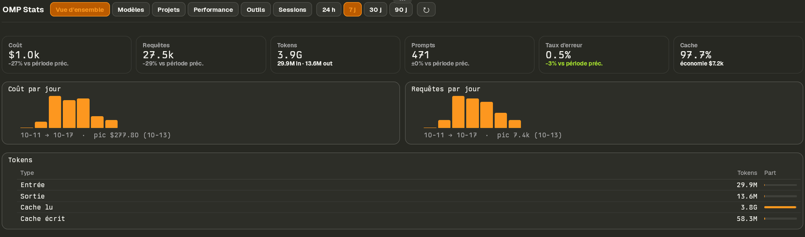
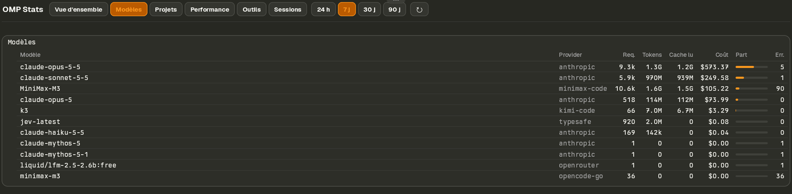
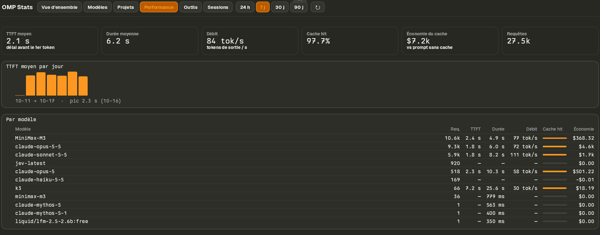
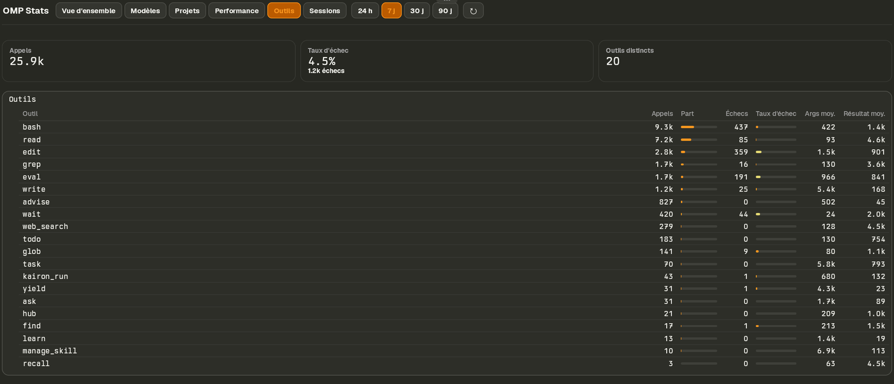

# OMP Stats for Tern

A [Tern](https://docs.stencil.so/tern) block that turns the usage statistics omp (Oh My Pi) keeps in
`~/.omp/stats.db` into a live dashboard, built only from Tern's native components (`card`, `table` with meter cells,
`bars`). It answers "how much did I use my agents this week, on which models and projects, and what did it cost?"
without leaving the terminal.



The interface is in French.

## Tabs

| Tab | Shows |
|---|---|
| Vue d'ensemble | Cost, requests, tokens, prompts, error rate, cache hit and saving, each against the previous period; cost and request trends; token mix |
| Modèles | Per model and provider: requests, tokens, cost, share of cost, errors |
| Projets | Per project directory and per agent type (main / subagent / advisor) |
| Performance | TTFT, duration, output speed, cache hit and saving; TTFT trend; per model |
| Outils | Calls and failure rate per tool |
| Sessions | Most recently active sessions: start, project, duration, requests, cost, models |

Periods: 24 h, 7 j, 30 j, 90 j. Windows are calendar-aligned, and "previous period" is the same length right before.





## Requirements

- Tern, developed and tested against 0.9.2 on Linux. Other versions and platforms are untested.
- `sqlite3` on the machine (the CLI; any version that supports `-json`, 3.33+).
- omp, with its stats database at `~/.omp/stats.db` (omp creates it; `omp stats` also syncs it).

## Install

```sh
git clone https://github.com/BaLaurent/tern-omp-stats
tern plugin link ./tern-omp-stats      # then: command palette → "OMP Stats"
```

`tern plugin link` uses the plugin where it is; `tern plugin unlink omp-stats` removes it.

Keys: `1`–`4` period, `←`/`→` (or `h`/`l`, `Tab`) tab, `r` refresh. Click works on every tab and period button.
The active tab refreshes every 30 s; the other tabs keep their last data and refresh when selected. The chosen tab and
period are restored when Tern restarts.

## How it reads the data

- `tern.db` only exists in a plugin's window half and a block lives in the host half, so statements run through
  `sqlite3 -readonly -json ~/.omp/stats.db`. The database is never written.
- It reads the raw `messages`, `tool_calls` and `user_messages` tables, **not** the rollup tables: omp rebuilds those
  only when `omp stats` runs (which first syncs all session files and can take minutes), and nearly every hour is
  marked dirty. The block therefore shows what omp has already recorded; the footer says how old the newest request is.
- Every statement is bounded by the period and range-searches the timestamp index. Group keys carry a unary `+`
  (`GROUP BY +model`) so SQLite does not pick a whole-history index; `tests/test_queries.luau` pins this with
  `EXPLAIN QUERY PLAN`. On a 900 MB database every statement of every tab and period ran in under 0.7 s with a warm
  cache. A cold cache (first read of the file) takes longer; the block keeps showing its last data meanwhile.
- The native `bars` chart only shows labels as tooltips, so each trend carries a caption: first and last bucket, and
  the peak with its date.

## Develop

```sh
rokit install                                  # lune, luau-lsp
tern plugin types .                            # writes tern.d.luau (git-ignored)
luau-lsp analyze --platform=standard --definitions=@tern=tern.d.luau host.luau lib/*.luau
lune run tests/run.luau                        # ranges, fmt, SQL against a fixture db, the block end to end
```

Layout: `host.luau` (block: state, keys, clicks, refresh), `lib/queries.luau` (all SQL), `lib/db.luau` (runs it),
`lib/ranges.luau` (periods and bucket SQL), `lib/fmt.luau`, `lib/parts.luau` (shared widgets),
`lib/view_*.luau` (one per tab: data in, nodes out, no SQL), `stats.css`.

The test suite loads `host.luau` under a stub of Tern's runtime and runs the real `sqlite3` against a fixture database
shaped like omp's, so queries, plans, refresh, stale-answer handling and every tab render are exercised end to end.

## License

[MIT](LICENSE)
